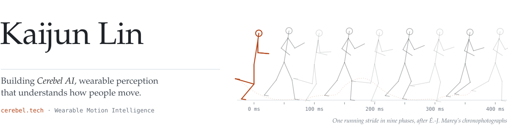
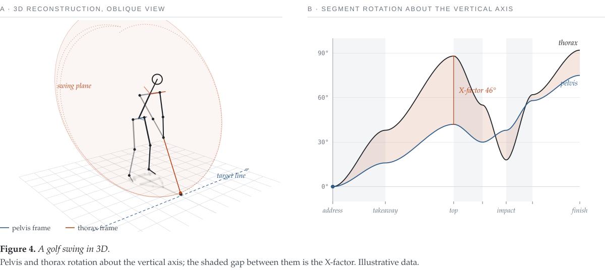
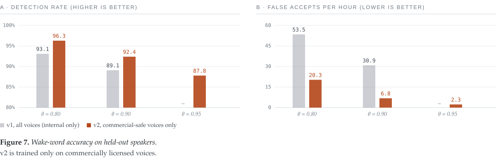

<picture>
  <source media="(prefers-color-scheme: dark)" srcset="assets/header-dark.r5.svg">
  
</picture>

I work on [Cerebel AI](https://cerebel.tech): AR glasses that see and hear what you do, and a cloud pipeline that turns phone video into joint angles and coaching feedback. Based in Boston.

### Cerebel glasses

Monocular AR glasses with a green microLED waveguide display, a camera and a microphone. A small Linux board in the frame handles capture and display; captions, translation and the voice assistant run together with a phone and a cloud service.

<picture>
  <source media="(prefers-color-scheme: dark)" srcset="assets/glasses-dark.r5.svg">
  
</picture>

### Motion analysis

<picture>
  <source media="(prefers-color-scheme: dark)" srcset="assets/system-dark.r5.svg">
  
</picture>

<picture>
  <source media="(prefers-color-scheme: dark)" srcset="assets/recon-dark.r5.svg">
  
</picture>

<picture>
  <source media="(prefers-color-scheme: dark)" srcset="assets/golf-dark.r5.svg">
  
</picture>

### [cervical-retarget](https://github.com/Gary-Lin08/cervical-retarget) &nbsp;open source · Python · OpenSim

An articulated neck and head for markerless OpenSim inverse kinematics. Two cervical joints are added to the Rajagopal model and driven by landmarks derived from GEM-X joints; on two recorded sessions, head-orientation error drops by 34–36%.

<picture>
  <source media="(prefers-color-scheme: dark)" srcset="assets/crhero-dark.r5.svg">
  
</picture>

### [Hey Cerebel](https://github.com/Gary-Lin08/cerebel-wake-word)

The wake word that runs on the glasses: a TC-ResNet with about 20k parameters, written in C for the firmware and trained only on synthetic speech (11,843 clips).

<picture>
  <source media="(prefers-color-scheme: dark)" srcset="assets/wake-dark.r6.svg">
  
</picture>

<picture>
  <source media="(prefers-color-scheme: dark)" srcset="assets/results-dark.r6.svg">
  
</picture>

### [Tennis AI](https://github.com/Gary-Lin08/Tennis-AI)

A monocular perception stack for tennis. A TrackNet heatmap network finds the ball in every frame, a court homography puts each detection in metres, a physics-based detector finds bounces and calls them in or out, MoveNet pose feeds a recurrent stroke classifier, and a state machine turns the events into rallies and a score. The networks run on device as Core ML models.

<picture>
  <source media="(prefers-color-scheme: dark)" srcset="assets/tennis-dark.r6.svg">
  
</picture>

<picture>
  <source media="(prefers-color-scheme: dark)" srcset="assets/tmodel-dark.r6.svg">
  
</picture>

### Other

- [agent-team-cli](https://github.com/Gary-Lin08/agent-team-cli): run several coding agents in parallel in split terminal panes (TypeScript).

Python · PyTorch · C · Swift / Core ML · TypeScript · OpenSim
