  

  
  
  

 

### `$ whoami`

I build systems that **see, hear and understand human movement**, all the way from firmware on a pair of AR glasses to 3D musculoskeletal models in the cloud.

- 🥽 **Edge ML.** Tiny models that run on the glasses frame. My wake-word network has about 20k parameters and its C port matches PyTorch to 6 decimal places.
- 🦴 **Biomechanics.** Video goes to a 3D pose and body mesh, then OpenSim inverse kinematics produces joint angles and loads, and those feed coaching.
- 🤖 **Agent tooling.** Orchestrating teams of coding agents from one terminal.
- 🎯 **Principle.** The language model explains; deterministic tools compute. Every number a user sees should be traceable.

 

## ◆ What I'm building

  

  

 

## ◆ Featured work

<table>
  <tr>
    <td width="50%" valign="top">
      
    </td>
    <td width="50%" valign="top">
      
    </td>
  </tr>
  <tr>
    <td width="50%" valign="top">
      
    </td>
    <td width="50%" valign="top">
      <b>More in progress.</b> Most of the Cerebel stack (glasses firmware, reconstruction server, coaching agent) is closed-source for now. Happy to walk through it. Reach out via <a href="https://cerebel.tech">cerebel.tech</a>.
    </td>
  </tr>
</table>

 

## ◆ Algorithm spotlight: keyword spotting on a glasses frame

  

<b>How it works</b> (click to expand)

 

| Stage | What happens |
|---|---|
| **(a) Audio** | 16 kHz mono from the frame microphone, sliding 1.5 s window |
| **(b) Features** | 40-band log-mel spectrogram, recomputed every 50 ms |
| **(c) Model** | TC-ResNet: temporal 1-D convolutions treat mel bands as channels, about 20k parameters and under 1M MACs |
| **(d) Decision** | Fires only when **two consecutive** scores clear θ = 0.85; the cloud then re-verifies |
| **Data** | 100% synthetic speech: 1,000+ TTS speakers, augmented with noise, room reverb, a glasses-mic frequency response, and "Hey …" half-phrases as hard negatives |

The C inference code is checked against PyTorch on every release, with a max absolute difference of 4 × 10⁻⁶.
→ [cerebel-wake-word](https://github.com/Gary-Lin08/cerebel-wake-word)

 

## ◆ Toolbox

  
  
  
  
  
  
  
  
  
  
  
  
  

 

  

