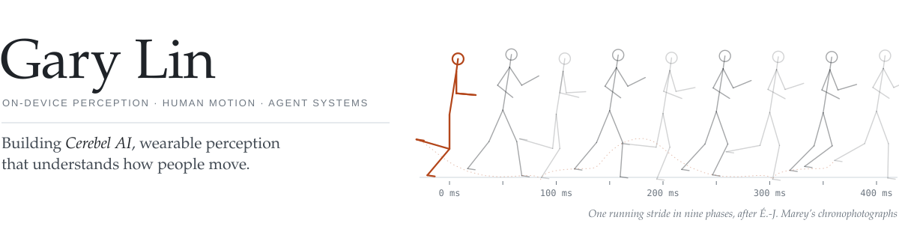
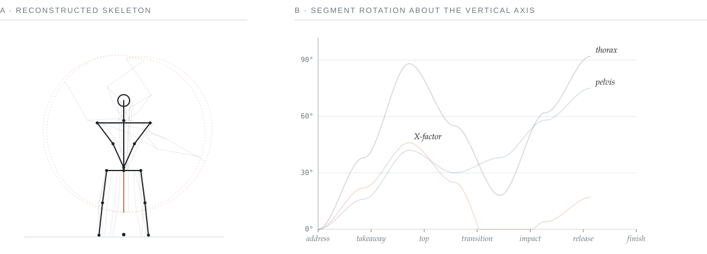

<picture>
  <source media="(prefers-color-scheme: dark)" srcset="assets/header-dark.svg">
  
</picture>

I work on perception for wearables. That covers small models that run on a pair of AR glasses, and the cloud pipeline that turns ordinary video into a musculoskeletal model of how someone moves. I like systems where a language model does the explaining, but every number it quotes comes from a deterministic tool.

Currently building **[Cerebel AI](https://cerebel.tech)**. Based in Japan.

 

#### Selected work

**Cerebel motion stack** &nbsp;closed source 
Wearable capture, on-device triggers, 3D body reconstruction, OpenSim inverse kinematics, and a coach grounded in measured joint angles.

<picture>
  <source media="(prefers-color-scheme: dark)" srcset="assets/system-dark.svg">
  
</picture>

<picture>
  <source media="(prefers-color-scheme: dark)" srcset="assets/biomech-dark.svg">
  
</picture>

**[Hey Cerebel](https://github.com/Gary-Lin08/cerebel-wake-word)** &nbsp;PyTorch · C · speech synthesis 
The wake word for our glasses: a 20k-parameter temporal ResNet that runs in firmware. It was trained only on synthetic speech, 11,843 clips from more than 1,000 TTS voices.

<picture>
  <source media="(prefers-color-scheme: dark)" srcset="assets/wake-dark.svg">
  
</picture>

**[agent-team-cli](https://github.com/Gary-Lin08/agent-team-cli)** &nbsp;TypeScript · Ink · MCP 
Runs a team of coding agents in parallel and streams each one into its own terminal pane. It works with Cursor, Claude Code and Codex.

**[Tennis AI](https://github.com/Gary-Lin08/Tennis-AI)** &nbsp;SwiftUI · Core ML · Python 
On-device ball tracking, pose and shot recognition for tennis practice video, plus an offline rally and scoring pipeline.

**[Calculus BC Quest](https://gary-lin08.github.io/Calculus-BC-Quest/)** &nbsp;HTML 
A browser practice game covering all ten AP Calculus BC units and past papers from 2017 to 2022.

 

#### Tools

Python, PyTorch, C &nbsp;·&nbsp; Swift, Core ML &nbsp;·&nbsp; TypeScript, React, Node &nbsp;·&nbsp; OpenSim &nbsp;·&nbsp; FastAPI, Supabase

 

Reach me through <a href="https://cerebel.tech">cerebel.tech</a>. Figures are hand-built SVG, generated by <a href="tools/gen_figures.py">tools/gen_figures.py</a>.
