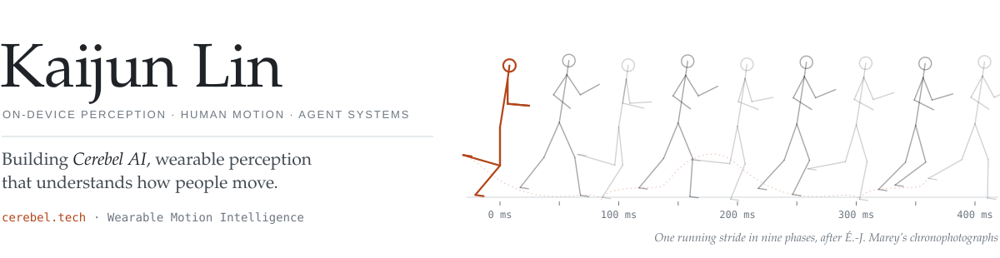
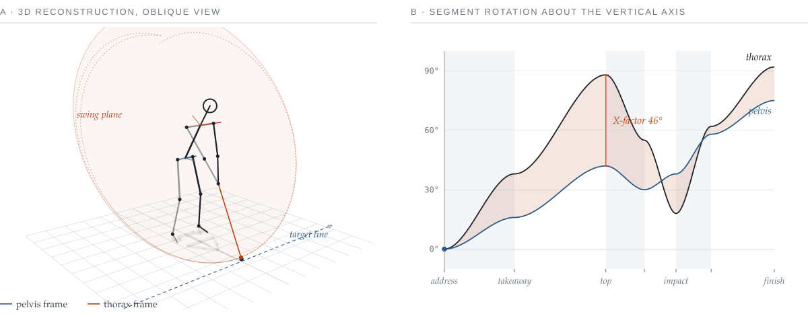

<picture>
  <source media="(prefers-color-scheme: dark)" srcset="assets/header-dark.r3.svg">
  
</picture>

I build perception for wearables. On one end are small models that run on a pair of AR glasses; on the other is a cloud pipeline that turns ordinary video into a musculoskeletal model of how someone moves. In between, a language model explains what happened, but every number it quotes comes from a deterministic tool.

  <a href="https://cerebel.tech"><b>Cerebel AI</b></a> &nbsp;·&nbsp; Wearable Motion Intelligence &nbsp;·&nbsp; <a href="https://cerebel.tech">cerebel.tech</a> &nbsp;·&nbsp; Japan

<table>
  <tr>
    <td width="33%" valign="top"><b>Edge perception</b> Wake words, capture and display on a 128 MB ARM board. Every model has to earn its milliwatts.</td>
    <td width="33%" valign="top"><b>Human motion</b> Monocular video to body mesh to musculoskeletal inverse kinematics, with joint angles you can defend.</td>
    <td width="33%" valign="top"><b>Agent systems</b> Language models that orchestrate tools and other agents, and never invent a number.</td>
  </tr>
</table>

 

### Cerebel glasses &nbsp;closed source

A monocular waveguide display, a camera and a microphone on a lightweight Linux frame. The glasses run captions, translation, a voice assistant and photo capture, and they show coaching cues mid-session.

<picture>
  <source media="(prefers-color-scheme: dark)" srcset="assets/glasses-dark.r3.svg">
  
</picture>

<b>Figure 1.</b> <i>The glasses, as a line drawing.</i> Callouts mark where each part sits. On the right, the display at its native resolution: the wearer asks about a swing and gets a number back.

 

### Cerebel motion stack &nbsp;closed source

<picture>
  <source media="(prefers-color-scheme: dark)" srcset="assets/system-dark.r3.svg">
  
</picture>

<b>Figure 2.</b> <i>From a glance to a coaching cue.</i> Video (orange) is reconstructed into a musculoskeletal model in the cloud; audio (blue) is gated on the glasses by a 20k-parameter wake word.

<picture>
  <source media="(prefers-color-scheme: dark)" srcset="assets/recon-dark.r3.svg">
  
</picture>

<b>Figure 3.</b> <i>Video to mesh to muscles.</i> The body mesh is estimated with GEM-X and joint kinematics are solved with <a href="https://opensim.stanford.edu/">OpenSim</a> inverse kinematics. The renderings here are my own schematic drawings, not output from either tool.

<picture>
  <source media="(prefers-color-scheme: dark)" srcset="assets/golf-dark.r3.svg">
  
</picture>

<b>Figure 4.</b> <i>A golf swing in 3D.</i> The pelvis and thorax frames rotate on the swing plane. The shaded gap between their rotation curves is the X-factor, which peaks at the top of the backswing. Illustrative data.

 

### [Hey Cerebel](https://github.com/Gary-Lin08/cerebel-wake-word) &nbsp;PyTorch · C · speech synthesis

The glasses' wake word: a 20k-parameter temporal ResNet that runs in firmware. It was trained only on synthetic speech, 11,843 clips from more than 1,000 TTS voices.

<picture>
  <source media="(prefers-color-scheme: dark)" srcset="assets/wake-dark.r3.svg">
  
</picture>

<b>Figure 5.</b> <i>Keyword spotting on a glasses frame.</i> A temporal ResNet over 40 mel bands. The C port that ships in firmware matches PyTorch to six decimal places.

 

### [Tennis AI](https://github.com/Gary-Lin08/Tennis-AI) &nbsp;SwiftUI · Core ML · Python

On-device ball tracking, pose and shot recognition for tennis practice video, plus an offline pipeline that splits rallies and keeps score.

<picture>
  <source media="(prefers-color-scheme: dark)" srcset="assets/tennis-dark.r3.svg">
  
</picture>

<b>Figure 6.</b> <i>Ball tracking on a calibrated court.</i> Four keypoints fix the court homography, and each bounce is projected onto the ground plane. Illustrative rally.

 

### Also

**[agent-team-cli](https://github.com/Gary-Lin08/agent-team-cli)** &nbsp;TypeScript · Ink · MCP 
Runs a team of coding agents in parallel and streams each one into its own terminal pane. It works with Cursor, Claude Code and Codex.

**[Calculus BC Quest](https://gary-lin08.github.io/Calculus-BC-Quest/)** &nbsp;HTML 
A browser practice game covering all ten AP Calculus BC units and past papers from 2017 to 2022.

 

### Tools

Python, PyTorch, C &nbsp;·&nbsp; Swift, Core ML &nbsp;·&nbsp; TypeScript, React, Node &nbsp;·&nbsp; OpenSim &nbsp;·&nbsp; FastAPI, Supabase

 

Reach me through <a href="https://cerebel.tech">cerebel.tech</a>. Every figure on this page is hand-built SVG, generated by the scripts in <a href="tools/">tools/</a>.
